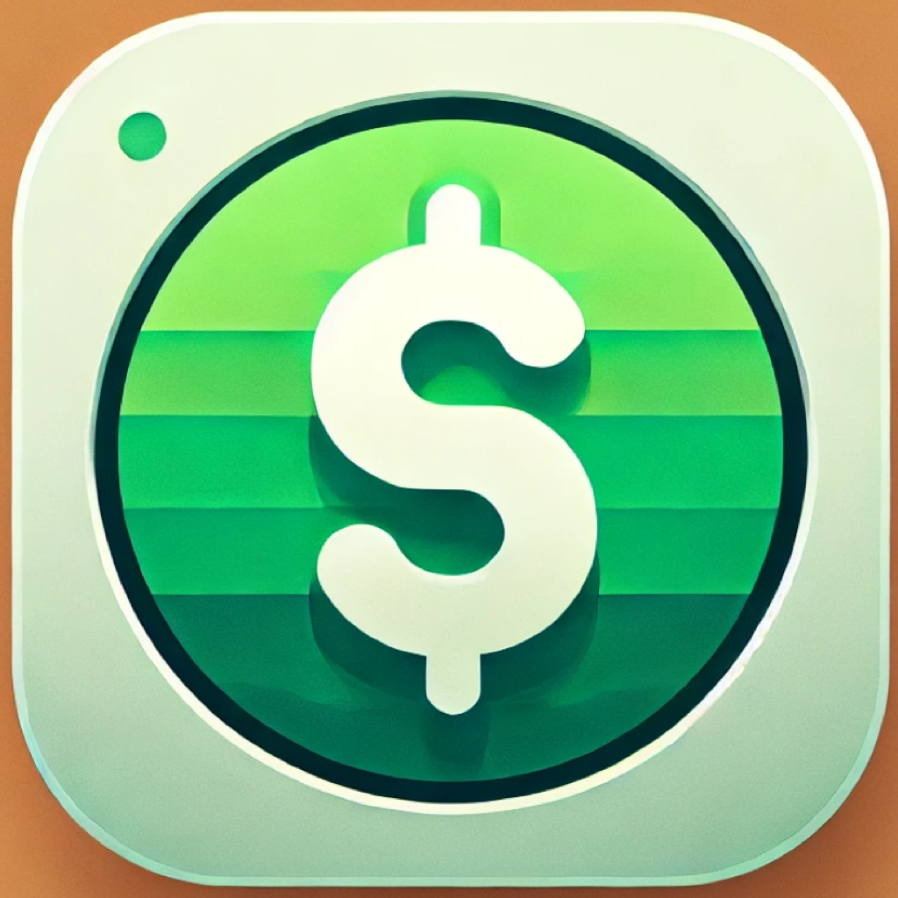
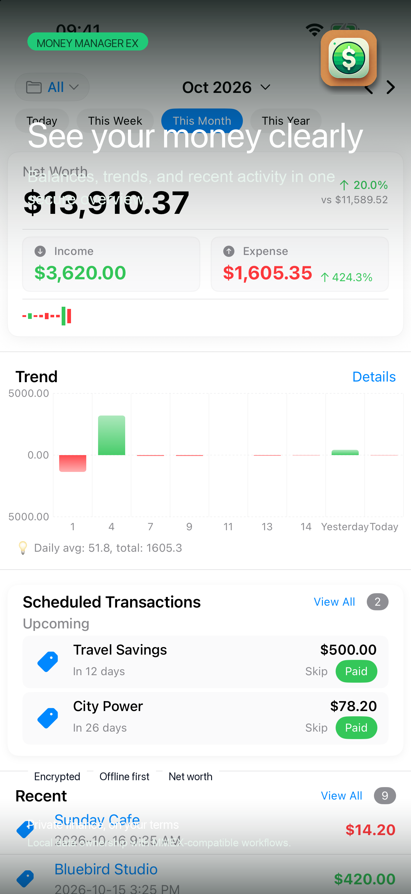
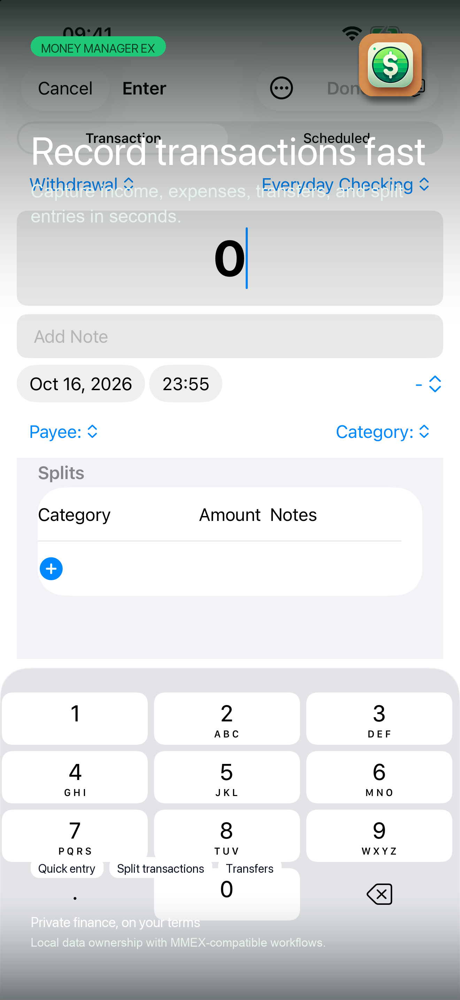
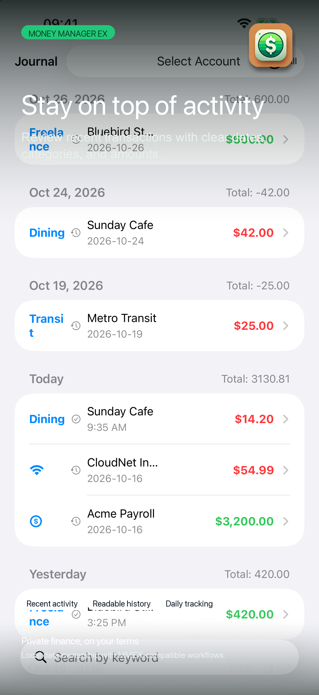
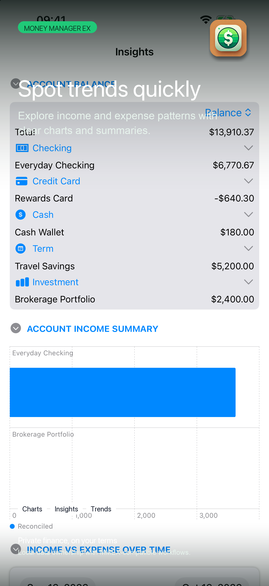
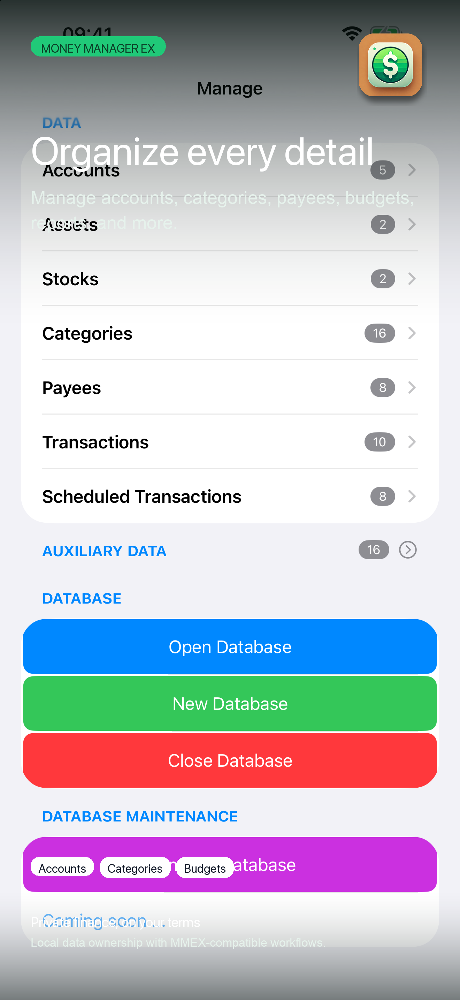
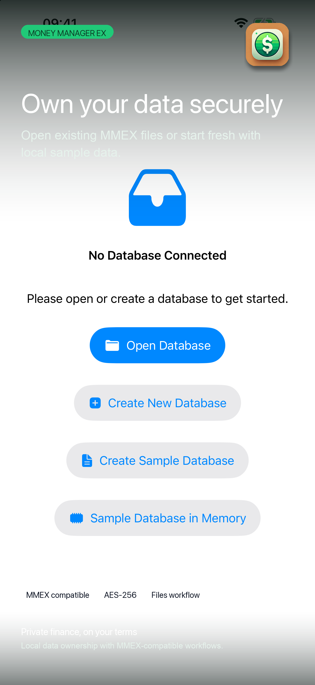
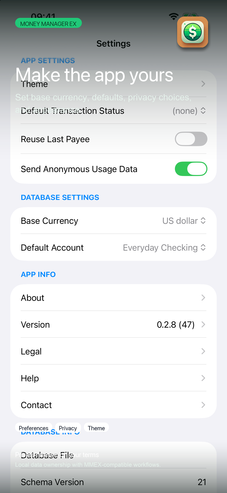

# Money Manager Ex for iOS

  

  <strong>Secure personal finance on iPhone with local, encrypted, MMEX-compatible data.</strong>

  Track accounts, transactions, categories, budgets, and reports while keeping your database under your control.

  <a href="https://apps.apple.com/us/app/money-manager-ex/id6683300571">Download on the App Store</a>
  ·
  <a href="https://testflight.apple.com/join/SYakQaAv">Join TestFlight</a>
  ·
  <a href="./docs/app-store-release-assets.md">View App Store asset pack</a>

## Why Money Manager Ex for iOS

Money Manager Ex for iOS (MMEX4iOS) is the mobile companion to the Money Manager Ex ecosystem on desktop and Android. It is designed for people who want practical finance tracking without giving up control of their data.

### Highlights

- **Private by default** — manage your finances with local storage and AES-256 database encryption.
- **MMEX-compatible workflow** — work with the same data model used by [MMEX Desktop](https://github.com/moneymanagerex/moneymanagerex) and [MMEX Android](https://github.com/moneymanagerex/android-money-manager-ex/).
- **Useful day-to-day finance tools** — record regular, split, and transfer transactions; manage accounts, categories, payees, and more.
- **Clear insights** — review balances, trends, and recent activity with SwiftUI-based dashboards and charts.
- **Document-based sync model** — use the iOS Files workflow to open and manage databases.

## Screenshots

The repository now includes a fresh screenshot set captured from the current simulator build, plus a generated marketing set for GitHub Pages and App Store planning.

> These screenshots are generated from a real app run with sample data. Final App Store submission still benefits from a human review pass for copy, localization, and exact device-target compliance. See [docs/app-store-release-assets.md](./docs/app-store-release-assets.md) for the full capture and asset plan.

  
  
  

  
  
  

  

### Screenshot sources

- Fresh raw captures: [Screenshots/2026-refresh/raw/](./Screenshots/2026-refresh/raw/)
- Generated marketing set: [docs/assets/app-store/](./docs/assets/app-store/)
- Generator script: [scripts/generate_app_store_screenshots.py](./scripts/generate_app_store_screenshots.py)
- Screenshot-mode app entry: [ContentView.swift](./MMEX/App/ContentView.swift)

### Planned next screenshot sequence

For the next App Store recapture, the recommended order is:

1. Overview hero
2. Transaction entry
3. Journal / recent activity
4. Insights / charts
5. Manage / organization
6. Database ownership and onboarding
7. Settings / personalization

## Features

### Core finance management

- Regular transactions
- Split transactions
- Transfer transactions
- Accounts and currencies
- Payees and categories
- Budgets, tags, reports, and attachments

### User experience

- SwiftUI-based interface
- Charts for reports and financial insights
- Theme and preference settings
- Multi-language support

### Security and compatibility

- AES-256 encrypted database support
- MMEX data model compatibility
- Files-based database workflow

## App Store release assets

Use [docs/app-store-release-assets.md](./docs/app-store-release-assets.md) for:

- App Store metadata copy
- Screenshot ordering and positioning
- App preview storyboard
- Localization starter copy
- Screenshot regeneration notes

## Tech stack

- [SwiftUI](https://developer.apple.com/xcode/swiftui/)
- [Swift Charts](https://developer.apple.com/documentation/charts) for reports and insights
- [SQLite.swift](https://github.com/stephencelis/SQLite.swift) for the current ORM and data access layer
- [MMEX Data Model](https://github.com/moneymanagerex/database) for cross-platform data compatibility
- [SQLite3MultipleCiphers](https://github.com/utelle/SQLite3MultipleCiphers) for encrypted database support

## Architecture

- [Architecture and MVVM roadmap](./docs/architecture.md)
- [SQLite.swift to GRDB migration plan](./docs/sqlite-to-grdb-migration.md)

## Build

### Requirements

- Xcode
- Optional: iPhone or iPad device for on-device validation

### Dependencies

- [SQLite.swift manual installation guide](https://github.com/stephencelis/SQLite.swift?tab=readme-ov-file#manual)
- [Amplitude-iOS](https://github.com/amplitude/Amplitude-iOS) manual installation

### Local build flow

1. Clone this repository.
2. Set up the required manual dependencies.
3. Open the Xcode project.
4. Build and run the app.

## Contributing

This project is still evolving, and contributions are welcome across development, design, testing, and localization.

- **Developers** — improve product flows, data handling, and platform quality.
- **Designers** — help refine visual polish, onboarding, and finance workflows.
- **Beta testers** — join via [TestFlight](https://testflight.apple.com/join/SYakQaAv).
- **Translators** — contribute on [Crowdin](https://crowdin.com/project/iosmmex).

## Inspiration

- [Dime](https://github.com/rarfell/dimeApp)
